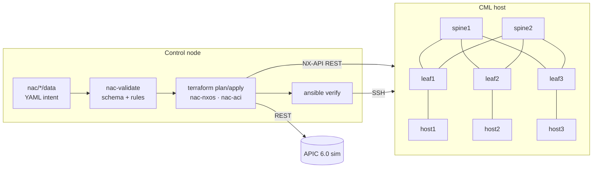

# Data Center Network as Code

[](https://github.com/Dbarrios080791/DC_Automation/actions/workflows/ci.yml)

A home-lab Data Center built to **design, automate and operate a Cisco VXLAN EVPN fabric and Cisco ACI as code**,
following Cisco's [Network as Code](https://netascode.cisco.com) (NaC) framework.

> Intent lives in YAML. Code is generic. Every change is validated before it touches a device,
> applied declaratively and verified afterwards.

| Layer | Tooling |
|---|---|
| Lab infrastructure | Cisco Modeling Labs 2.x, managed with **Terraform** (`CiscoDevNet/cml2`) |
| NX-OS fabric (VXLAN EVPN) | **Terraform** + Cisco NaC module [`nac-nxos`](https://registry.terraform.io/modules/netascode/nac-nxos/nxos) |
| ACI (APIC 6.0 simulator) | **Terraform** + Cisco NaC module [`nac-aci`](https://registry.terraform.io/modules/netascode/nac-aci/aci) |
| Pre-change validation | [`nac-validate`](https://github.com/netascode/nac-validate) with custom semantic rules |
| Post-change verification / day-2 | **Ansible** (`cisco.nxos`) |
| On-box & API scripting | **Python** (NX-OS on-box `cli` API, NX-API) |
| Quality gates | pre-commit, yamllint, ansible-lint, ruff, pytest, GitHub Actions |

## Architecture



**Fabric NaC:** 2 spines (OSPF underlay, iBGP EVPN route-reflectors) + 3 leafs (VTEPs, anycast gateway,
ingress replication) + 3 Alpine hosts. Tenant A: VRF `TENANT-A` (L3VNI 50001), WEB VLAN 10 → L2VNI 10010,
APP VLAN 20 → L2VNI 10020.

## Repository layout

```
├── nac/
│   ├── nxos/              # NX-OS fabric as code
│   │   ├── data/          #   source of truth: global → device_groups → devices, one file per tenant
│   │   ├── rules/         #   nac-validate semantic rules (unique loopbacks, /31 links, VNI consistency)
│   │   ├── cml/           #   CML topology of the automation fabric
│   │   └── main.tf        #   just wires data/ to the official Cisco module
│   └── aci/               # ACI as code (tenants + access policies)
├── labs/                  # MANUAL class labs (DCExperts), isolated from automation
├── cml/terraform/         # labs-as-code: one Terraform workspace (state) per lab
├── ansible/               # verification & day-2 ops, inventory scoped to the NaC fabric only
├── python/
│   ├── onbox/             # runs inside NX-OS (python3 + cli API, EEM-schedulable)
│   └── offbox/            # NX-API tooling reading the NaC source of truth
├── tests/                 # offline tests (rules, inventory consistency)
└── docs/                  # setup, CML sizing, addressing plan, workflow, roadmap (Spanish)
```

## Quick start

```bash
make setup                         # venv + deps + Ansible collections + git hooks
vi .env                            # CML / NX-OS / APIC credentials (git-ignored)

make lab-up LAB=nac/nxos/cml       # boot the automation fabric in CML
make deploy                        # validate → plan → confirm → apply → verify
```

Day-to-day change (e.g. a new tenant): add `nac/nxos/data/21-tenant-b.nac.yaml` → `make nxos-plan` →
review → `make nxos-apply` → `make verify`. See [docs/04-flujo-nac.md](docs/04-flujo-nac.md).

## Design decisions

- **Separation of learning and automation.** Class labs (`labs/`) are configured by hand, have their own CML state and
  management range, and are absent from every automation inventory. The NaC fabric is never touched by hand.
- **Data/logic separation (NaC).** No Terraform logic is written here: the YAML model is consumed by Cisco-maintained
  modules. Shared intent is expressed once with `global`, `device_groups` and per-device `variables`.
- **Tenants as device groups.** Each tenant is its own file/group, so services stack without editing the underlay.
- **Shift-left validation.** Semantic rules catch design errors (duplicate router-IDs, half-configured /31 links,
  VNI reuse) before `terraform plan`.
- **Declarative config, imperative verification.** Terraform owns configuration; Ansible proves the network converged.
- **No secrets in git.** Credentials come from `.env`/environment; day-0 passwords are injected at lab creation.

## Roadmap

See [docs/05-roadmap.md](docs/05-roadmap.md). Next: vPC on leafs, border leaf with external VRF-lite,
`nac-test` post-change tests, EVPN multisite, NDFC (`cisco.nac_dc_vxlan`).
